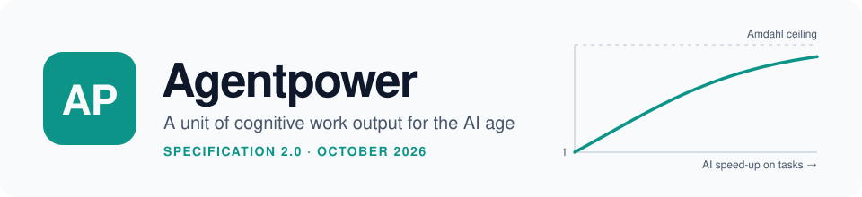
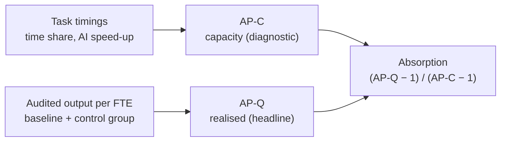

<!--
SPDX-FileCopyrightText: 2026 Alphin Tom / Mycel UG (haftungsbeschränkt)

SPDX-License-Identifier: CC-BY-SA-4.0
-->

<p align="center">
  <picture>
    <source media="(prefers-color-scheme: dark)" srcset="docs/assets/banner-dark.svg">
    
  </picture>
</p>

<p align="center">
  <a href="https://github.com/MycelAI/agentpower/releases/latest"></a>
  <a href="LICENSE"></a>
  <a href="LICENSE-CODE"></a>
  <a href="pyproject.toml"></a>
</p>

<p align="center">
  <a href="docs/definition.md">Definition</a> ·
  <a href="docs/measurement.md">Measurement</a> ·
  <a href="docs/economics.md">Economics</a> ·
  <a href="docs/evidence.md">Evidence</a> ·
  <a href="docs/simulation.md">Simulation</a> ·
  <a href="docs/faq.md">FAQ</a> ·
  <a href="CONTRIBUTING.md">Contributing</a>
</p>

> **One agentpower (AP)** is the quality-adjusted output of one full-time-equivalent year of knowledge work in a given role, at that role's productivity without generative AI.

An **AP ratio** of 1.3 means each FTE now delivers 30% more audited value than the same role did unaided.

## Quickstart

You need Python 3.10+ and [uv](https://docs.astral.sh/uv/). No install step is required: `uvx` fetches the package from GitHub.

```bash
curl -O https://raw.githubusercontent.com/MycelAI/agentpower/v2.0.0/examples/tasks.csv
uvx --from "git+https://github.com/MycelAI/agentpower@v2.0.0" agentpower estimate tasks.csv --realised 1.12 --cost 2400
```

```text
AP-C (capacity): 1.37  [Redesigned]
AP-Q (realised): 1.12  [Integrated]
Absorption:      33%
Cost per extra AP: EUR 20,000/year
```

The CSV lists a role's tasks with their share of working time and the hours each takes with and without AI ([example](examples/tasks.csv)). Here, AI could lift the role to 1.37, the team actually delivers 1.12, and so a third of the possible gain reaches output. From a clone, the same in Python:

```bash
git clone https://github.com/MycelAI/agentpower.git && cd agentpower
uv run python -c "from agentpower import capacity_ap, band; ap = capacity_ap([0.4, 0.3, 0.3], [2.0, 1.2, 1.0]); print(round(ap, 2), band(ap))"
```

```text
1.33 Integrated
```

## Why this exists

In 1783 James Watt needed to sell steam engines to people who owned horses, so he defined a horsepower: 33,000 foot-pounds a minute. It was a translation layer. It let a mill owner compare a machine to the animals in his stable.

Knowledge work needs the same thing now. Token bills tell you how much fuel was burned, not how much work was done; that is like judging a factory by its coal bill. Agentpower measures the work: what a human–AI system delivers, against what the same role delivered without AI.

## The two measures



```
AP-Q (realised) = output per FTE now / output per FTE at baseline
                  × audited quality now / audited quality at baseline
                  ÷ drift of a control group

AP-C (capacity) = 1 / Σ (time share of task i / AI speed-up on task i)

Absorption      = (AP-Q − 1) / (AP-C − 1)
```

AP-Q is the headline: what actually got delivered. AP-C is the diagnostic: how far the role could go if every saved minute became output. Their ratio shows where the gains leak away: unused time, review queues, demand. Report them like this:

```
AP-Q 1.14 [90% CI 1.02–1.27] · DiD control · 80 audits · FY2025 vs FY2022 · role: claims handling
```

How to run it: [docs/measurement.md](docs/measurement.md).

## Stage bands

| AP | Stage | Where it is seen in 2026 |
|---|---|---|
| < 0.98 | Below baseline | ~15% of individual workers in a typical organisation lose time to AI |
| 0.98–1.02 | Baseline | Within noise of no effect |
| 1.02–1.10 | Assisted | Typical organisation; matches measured time savings of 3–5% |
| 1.10–1.35 | Integrated | High adoption, redesigned workflows, exposed roles |
| 1.35–2.0 | Redesigned | Agentic frontier teams |
| 2.0–4.0 | Delegated | Not yet observed organisation-wide with rigorous measurement |
| ≥ 4.0 | Speculative | Needs AI to remove >80% of baseline time, all of it reused |

<p align="center">
  <picture>
    <source media="(prefers-color-scheme: dark)" srcset="docs/figures/calibration-dark.svg">
    
  </picture>
</p>

The reason 3–10 is so far away is Amdahl's law. To reach AP 3, AI must remove two thirds of a role's working time *and* the organisation must turn all of it into output. A fivefold speed-up on a task is common; a fivefold speed-up on a job is not.

## The economics

AI is two to five times cheaper per unit of output than hiring. That is a structural shift, and it is the honest form of the original argument. It is not a hundred times cheaper, and spend beyond a role's Amdahl ceiling buys almost nothing. In the calibrated scenarios one additional AP costs **€17,000–€45,000 a year**, against about €85,000 for a fully loaded hire. See [docs/economics.md](docs/economics.md).

## What changed in 2.0

Version 1.0 (April 2026) introduced the idea. Version 2.0 keeps the idea and rebuilds the measurement, after a review of the evidence and a Monte Carlo study of eight candidate methods across 1,500 simulated organisations.

<details>
<summary><strong>1.0 vs 2.0 at a glance</strong></summary>

| | 1.0 | 2.0 |
|---|---|---|
| Typical AP ratio | 3–10 | **1.02–1.10** for a typical 2026 organisation; 1.1–1.35 for integrated teams; up to ~2 at the agentic frontier |
| How to measure | Estimate the headcount you'd need without AI | **AP-Q**: quality-audited output per FTE against a control group, with a confidence interval, plus **AP-C**: task-based capacity |
| Cost of one extra AP | €16–€560/year in tokens | **€17,000–€45,000/year** all-in, against ~€85,000 for a hire |
| Production function | `Y = f(L × T)` (zero output without tokens) | Task-based Amdahl form; reduces to the baseline when AI is absent |
| Evidence | Klarna revenue per head, a CTO anecdote | 20+ controlled and population studies, see [evidence.md](docs/evidence.md) |

1.0 figures are not comparable with 2.0. The [changelog](CHANGELOG.md#200---2026-10-19) has the full list and migration notes.

</details>

## Reference code and simulation

The `agentpower` Python package implements the estimators, a synthetic-world model and the eight experiments that chose the 2.0 methods.

| Command | What it does |
|---|---|
| `uv run agentpower estimate examples/tasks.csv [--realised X] [--cost EUR]` | AP-C from task timings; with `--realised`, absorption; with `--cost`, € per extra AP |
| `uv run --extra plots agentpower simulate --report docs/simulation-results.md --figures docs/figures` | Re-runs all experiments (fixed seed, ~10–20 s) and rewrites the results, report and light/dark figures |
| `uv run pytest` | Runs the test suite |

Method and findings: [docs/simulation.md](docs/simulation.md). Generated numbers: [docs/simulation-results.md](docs/simulation-results.md). Raw output: [results/results.json](results/results.json).

**Requirements:** Python ≥ 3.10 and NumPy ≥ 1.26. Matplotlib ≥ 3.8 is needed only for figures (the `plots` extra). Tested on Windows with Python 3.12. The package is not published on PyPI; install it from GitHub as shown above.

## Limitations

- **AP is a ratio within a role.** It is never summed across roles, and comparison across organisations is only as good as the agreed deliverables and audit rubric.
- **Precision is limited.** One team in one period gives about ±12% at 80 audits, and no better than about ±10% with any number of audits. Pool teams and periods for finer claims.
- **Baselines age,** and audits can be gamed. Prefer a contemporaneous control group and blind, rotating reviewers.
- **Not all effects are productivity.** Deskilling and changes in job quality are outside the unit; report them alongside.
- **The simulation is a model.** Its conclusions about which methods work are robust; its levels are only as good as the calibration and will move as evidence arrives.

Details: [definition.md §8](docs/definition.md#8-limitations) and [simulation.md](docs/simulation.md#limits-of-the-simulation).

## How to use this

**Organisations.** Measure one role properly before you measure the company. Report AP-Q with its interval and AP-C beside it. If AP-C is high and AP-Q is not, your constraint is no longer the tools.

**Policymakers.** Track AP-Q by sector from audited samples, not from surveys or token sales. The adoption and reallocation levers (E6) are training and management, which is where public support has the most leverage.

**Individuals.** Your value is moving from producing to judging, directing and checking. The workers who gain most are those who know where the frontier is.

**Researchers.** The open problems are portable audit rubrics, role-level baselines, and measuring agentic delegation directly. See [CONTRIBUTING.md](CONTRIBUTING.md).

<details>
<summary><strong>Project structure</strong></summary>

```
agentpower/
├── README.md
├── CHANGELOG.md
├── CITATION.cff
├── CONTRIBUTING.md · CODE_OF_CONDUCT.md · SECURITY.md
├── LICENSE                ← project terms: which license covers what
├── LICENSE-CODE           ← MIT (code)
├── LICENSES/              ← full texts: CC-BY-SA-4.0, MIT
├── REUSE.toml             ← licensing of generated and data files
├── THIRD_PARTY_NOTICES.md
├── references.bib
├── pyproject.toml
├── docs/
│   ├── definition.md          ← formal specification 2.0
│   ├── measurement.md         ← how to measure AP-Q and AP-C
│   ├── economics.md           ← cost of an additional AP
│   ├── evidence.md            ← state of research, October 2026
│   ├── simulation.md          ← how the concepts were chosen
│   ├── simulation-results.md  ← generated numbers
│   ├── figures/               ← generated figures (light and dark)
│   ├── assets/                ← README banner
│   ├── faq.md
│   └── essay.md               ← link to the original essay
├── examples/
│   ├── ap-calculator.md       ← worksheet
│   └── tasks.csv              ← sample task timing input
├── src/agentpower/            ← estimators, model, experiments, CLI
├── tests/
└── results/results.json       ← raw simulation output
```

</details>

## Contributing and governance

Contributions of role baselines, measured cases, evidence, critiques and code are welcome. Start with [CONTRIBUTING.md](CONTRIBUTING.md).

- [Code of Conduct](CODE_OF_CONDUCT.md) (Contributor Covenant 3.0)
- [Security policy](SECURITY.md): report vulnerabilities privately
- [Changelog](CHANGELOG.md) and [versioning](CHANGELOG.md#changelog)
- [Code owners](.github/CODEOWNERS)

## Citation

Use GitHub's **Cite this repository** button (from [CITATION.cff](CITATION.cff)), or:

<details>
<summary><strong>BibTeX</strong></summary>

```bibtex
@techreport{tom2026agentpower2,
  title       = {Agentpower: A Unit of Cognitive Work Output for the AI Age. Specification 2.0},
  author      = {Tom, Alphin},
  institution = {Mycel UG (haftungsbeschr{\"a}nkt)},
  year        = {2026},
  month       = oct,
  url         = {https://github.com/MycelAI/agentpower}
}
```

</details>

## License

| Material | License |
|---|---|
| Text, documentation, figures, data | [CC BY-SA 4.0](LICENSES/CC-BY-SA-4.0.txt) |
| Code (`src/`, `tests/`, build and repository configuration) | [MIT](LICENSE-CODE) |
| Code of Conduct | CC BY-SA 4.0, adapted from the Contributor Covenant ([notices](THIRD_PARTY_NOTICES.md)) |

[LICENSE](LICENSE) has the complete terms, and every file carries an SPDX identifier. The word "agentpower" and the ideas are free for anyone to use; no trademark is claimed. The goal is adoption, not ownership.

## Origin

The concept was introduced in the essay ["Horsepower Then, Agentpower Now"](https://medium.com/alphin-pale-blue-dot/horsepower-then-agentpower-now-5bbeffabf3ef) (*Pale Blue Dot*, April 2026), which reflects specification 1.0. Project page: [mycel-ai.de/agentpower](https://mycel-ai.de/agentpower).

---

<p align="center"><strong>Agentpower</strong> is a project of <a href="https://mycel-ai.de">Mycel UG</a>, Berlin.<br><em>The engine doesn't have a moral compass. The operator does.</em></p>
