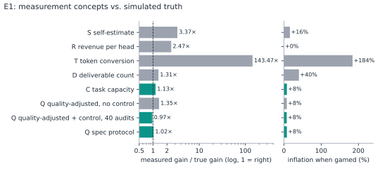
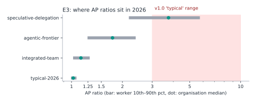
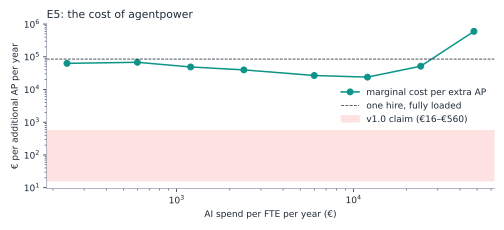

# Simulation: How the 2.0 Concepts Were Chosen

The numbers are in [simulation-results.md](simulation-results.md), generated by the code in [`src/agentpower`](../src/agentpower). To reproduce them:

```bash
uv run --extra plots agentpower simulate --report docs/simulation-results.md --figures docs/figures
```

One run takes about 20 seconds on a laptop. The seed is fixed, so results are identical across machines.

---

## Why simulate

A unit of measurement is a bet that one number tracks something real. You cannot test that bet on real organisations, because nobody knows their true AP; that is the problem the unit is meant to solve. So we build a synthetic world where the truth is known, give every candidate method only what a real organisation could observe, and see which one finds the truth.

## The synthetic world

Each worker splits baseline time across ten task types. On each task:

1. AI can address part of it (*exposure*), and the worker uses AI on it or not (*adoption*).
2. Inside the jagged frontier, AI saves time on the exposed part, minus the time spent checking its output (*review*), and may raise quality a little.
3. Outside the frontier (*frontier miss*), it costs time and quality.
4. Less experienced workers save more (*skill compression*).

A worker's capacity follows from Amdahl's law over those tasks. Only part of the freed time becomes output (*reallocation*); the rest goes into meetings, slack, other work or rest. True AP is realised output times quality. Organisations are 60 workers with a mix of part-time contracts and role-level differences in baseline output.

The parameters are calibrated to the published evidence ([evidence.md](evidence.md) §6). The typical-2026 scenario reproduces the measured economy-wide time savings of 3–5%, which is the anchor; the integrated and agentic scenarios extrapolate from it.

Around each organisation sit the things that are not AI: background productivity drift, price and demand moves, outsourcing, differences in token price and working style, and, when switched on, an incentive to game whatever is being measured.

## The experiments and what they decided

### E1. Which measurement concept? → AP-Q headline, AP-C diagnostic



Seven concepts were scored on 1,500 organisations. Three come from version 1.0.

- **Token conversion** (1.0's EUR/AP) overstates the gain 143-fold and almost triples when gamed. It ranks organisations only moderately (0.60), because tokens per unit of work vary by two orders of magnitude between model tiers and working styles.
- **Self-estimate** (1.0's calculator) overstates the gain 3.4-fold. People anchor on the time they feel they save, not on what ships, and they are optimistic.
- **Revenue per head** (1.0's Klarna table) overstates the gain 2.5-fold and barely ranks organisations correctly (0.26). Prices, growth and outsourcing swamp the AI signal.
- **Raw deliverable counts** are nearly unbiased when nobody is watching and inflate 40% when they are, because work gets split.
- **Task capacity (AP-C)** is the most precise (rank correlation 0.79) and resists gaming, but it measures what *could* be produced. It overstates realised gains where freed time is not reused.
- **Quality-adjusted output with a control group (AP-Q)** is unbiased (gain ratio 1.02 under the recommended protocol) and resists gaming (+8%), but it is noisier.

No single method wins on every criterion. The two that pass both tests, low bias and gaming resistance, measure different things: one realised value, one capacity. So 2.0 reports both, and their ratio (absorption) becomes a diagnostic in its own right.

### E2. Headcount or FTE? → FTE, ratio of totals

Counting heads instead of FTE adds up to ±7% error as the part-time share moves. Averaging individual ratios is a smaller error here (+0.3%), but the ratio of totals is correct by construction.

### E3 and E4. What range is real? → recalibrated stage bands



| Scenario | Organisation AP | Individual workers (10th–90th) |
|---|---|---|
| Typical 2026 | 1.02 | 0.99–1.07 |
| Integrated team | 1.14 | 1.02–1.28 |
| Agentic frontier | 1.75 | 1.24–2.40 |
| Speculative full delegation | 3.75 | 2.18–5.74 |

Version 1.0's "typical" 3–10 appears only in the speculative scenario. That scenario assumes AI addresses 92% of each task, saves 95% of that time, is used on 97% of tasks, misses 4% of the time, and the organisation turns 95% of freed time into output. Each of those is far outside anything measured. The bands in [definition.md](definition.md) §4 follow these quantiles.

About 15% of individual workers in a typical organisation end up *below* 1.0. Frontier misses are real, and an average hides them.

### E5. What does an AP cost? → €17–45K, not €16–560



| Scenario | AI spend per FTE | Cost per additional AP |
|---|---|---|
| Typical 2026 | €360 | ~€45,000 |
| Integrated team | €2,400 | ~€23,000 |
| Agentic frontier | €12,000 | ~€17,000 |

All are cheaper than an €85,000 hire. None is within two orders of magnitude of the 1.0 figure. Along the spend curve the marginal cost falls while AI is extending into new tasks, bottoms out at about €24,000 per extra AP when spend is around €12,000 per FTE per year, then climbs steeply as roles approach their Amdahl ceiling: past €24K, further spend buys almost nothing. The shape depends on an illustrative spend-response assumption. Varying it from €2,000 to €15,000 half-saturation moves the cheapest marginal AP between roughly €8,000 and €60,000, still at least fifteen times the top of the 1.0 range.

### E6. What moves AP? → adoption and reallocation matter as much as the model

Exposure, time saving, adoption and reallocation each swing integrated-team AP by 0.06–0.08 for a ±25% change. Review overhead and frontier misses matter about a third as much. Two of the four big levers are management, not model capability: whether people use the tools, and whether the organisation turns saved time into value.

### E7. How precise is AP-Q? → 80 audits, effort-weighted counts, ±12%

| Audits per period | 20 | 40 | 80 | 160 |
|---|---|---|---|---|
| 90% CI, effort-weighted | ±16% | ±13% | ±12% | ±10% |

Precision plateaus near ±10% because deliverable mix and baseline drift cannot be audited away. A single team can tell 1.0 from 1.3, not 1.05 from 1.10. Pool teams and periods for finer claims.

### E8. The Amdahl identity

To reach AP 3, AI must remove two thirds of a role's baseline time and the organisation must reuse all of it. With half reused, four fifths. This one table explains most of what 1.0 got wrong.

## Limits of the simulation

- It is a model. Its conclusions about *methods* (which ones are biased, which ones are gameable, and why) are robust to the parameter values. Its conclusions about *levels* (what AP is in 2026) are only as good as the calibration, and will move as evidence arrives.
- Agentic delegation, where an agent runs a whole task and a human reviews, is represented as high exposure and high saving on the same task model. If it changes the structure of jobs rather than speeding up their tasks, the model will understate it.
- Gaming channels are stylised. Real organisations will find others.

Re-run it with your own parameters: every scenario is a dataclass in [`model.py`](../src/agentpower/model.py).
